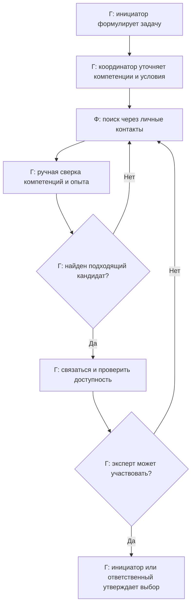
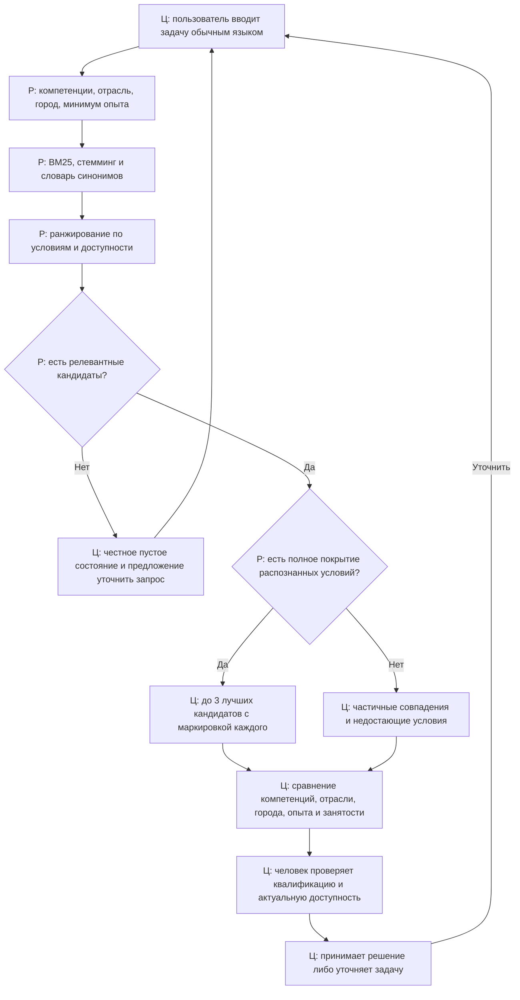

# AIID: AS-IS / TO-BE

Основания и неизвестные роли: [Discovery Matrix](DISCOVERY_MATRIX.md). **Ф** — подтверждено ТЗ, **Г** — реконструкция процесса без интервью, **Р** — существующий backend, **Ц** — целевой пользовательский сценарий, ещё требующий проверки UI.

## AS-IS: предполагаемый процесс

ТЗ подтверждает поиск через личные контакты и длительность в днях. Сбор требований, конкретный маршрут согласования и проверка занятости ниже — гипотезы, а не установленные регламенты AIID.

**Предполагаемые узкие места:** повторные обращения к посредникам, знание только части базы, неодинаковое толкование навыков и поздняя проверка занятости. Их наличие и значимость нужно подтвердить у координатора. Единственное прямо указанное узкое место — медленный поиск через контакты.

## TO-BE: от запроса к проверяемому короткому списку

CSV → PostgreSQL и работа retrieval уже реализованы. UI, действия пользователя и подтверждение возможности участия нельзя считать завершёнными по одному API. Обязательный текстовый сценарий не заменяется отраслевым dropdown.

### Когда полного соответствия нет

- `partial`: показать найденных кандидатов с `missing_requirements`, не скрывая несовпадение города/опыта/навыков. Город из запроса сейчас не жёсткий SQL-фильтр: другой город может появиться среди частичных результатов. Дополнительный фильтр `industry` — жёсткий.
- `no_matches`: не заполнять список произвольными людьми ради трёх карточек. Сообщить, что релевантных профилей нет. Уточнить у ментора, приемлема ли такая интерпретация требования топ-3 в сценарии отсутствия экспертов.
- `unrecognized_terms`: явно показать, что часть условий не понята. `full` и 100% относятся только к распознанным критериям и не означают понимания всего текста.
- Если есть один полный и два частичных кандидата, общий `status: ok` не делает всех троих полностью подходящими. Отображать статус каждого.
- Занятость влияет на порядок, но не входит в процент покрытия. Статус из CSV не является подтверждённым календарём эксперта.

## Что меняется

| Измерение | AS-IS | TO-BE | Что действительно известно |
|---|---|---|---|
| Время | По ТЗ — дни на поиск через контакты | Цель — выдача до 30 с; назначение эксперта остаётся отдельным процессом | Быстрый backend проверен ранее; сокращение общего цикла не измерено |
| Усилия | Г: ручные обращения и сверка профилей | Автоматический первоначальный список; человек проверяет основания | Количество шагов и трудозатраты AIID неизвестны |
| Прозрачность | Г: причины выбора могут оставаться у посредника | Система показывает совпадения и недостающие условия из реестра | Корректность объяснения не доказывает истинность исходных сведений |
| Качество выбора | Независимого baseline нет | Проверяемая релевантность топ-3; возможны ошибки словаря | Внутренние тесты не доказывают превосходство над координатором |
| Доступность | Г: выясняется через контакт с человеком | Предварительный приоритет по флагу, затем подтверждение человеком | Частота обновления реального статуса не согласована |
| Охват базы | Г: зависит от осведомлённости участников | Рассматриваются импортированные профили | Охват настоящего реестра AIID не проверен |

**Граница эффекта:** сегодняшний продукт сокращает вычислительную часть составления списка на синтетических данных. Экономия времени сотрудников и качество фактических назначений — предмет пилота, а не уже достигнутые показатели.
